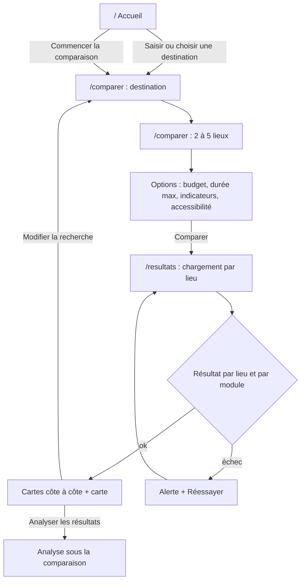

# CommuteLab · UX/UI design

Status: first draft, 26 November 2026.
Sources: SFG/SFD and development plan, database schema v1 draft, landing page HeroUI style (25 Nov).

> **Repo status:** this draft was written without access to the real repository, so the file tree in section 3 is a *proposal*, not an inspection. The Claude Code prompt (section 8) starts by inspecting the real tree and reconciling this document with it.

---

## 1. User journey

One task, one flow: *"I have a destination. Which of these communes works best for me?"*



| Step | What the user does | What must be clear |
|---|---|---|
| 1. Land | Reads the promise, types a destination or taps a quick pick (Châtelet, La Défense, Gare du Nord) | Scope is Paris and the petite couronne; sample data is labelled |
| 2. Destination | Chooses an address or a métro, RER, Transilien or tram station in Île-de-France | The destination is the arrival point; journeys start at each mairie |
| 3. Places | Picks 2 to 5 distinct arrondissements or communes (75, 92, 93, 94) | Minimum and maximum are enforced with a visible counter |
| 4. Options (optional) | Monthly budget, maximum journey time, indicators (all six by default, at least one), accessibility filters | Everything here is optional except the destination and places |
| 5. Results | Watches each place load independently, compares side by side | One failure never hides the other places (RG: keep every selected place visible) |
| 6. Adjust | Changes destination or budget and reruns | Previous selection is kept; no re-typing |
| 7. Analyse (F-07) | Clicks « Analyser les résultats » | Comparison stays visible; analysis appears below; failure offers « Réessayer » |

---

## 2. Routes

Router: `react-router-dom` (the app is a Vite SPA, so client-side routing is enough). The search itself lives in the **URL query string**, so a results page can be reloaded, bookmarked and shared.

| Path | Page | Feature | Phase | Notes |
|---|---|---|---|---|
| `/` | Landing | n/a | Week 1 | Built from the HeroUI mockup. Hero search card and quick picks navigate to `/comparer?dest=…` |
| `/comparer` | Search: destination, places, options | F-01, F-02 | Week 2 | Two clearly separate controls (destination vs comparison places). Mairie markers on a small map |
| `/resultats` | Side-by-side results + map | F-03, F-04, F-05, F-06, F-07 | Weeks 3–5, F-07 after launch | Reads everything from the query string |
| `/methodologie` | How it works and sources | n/a | Week 3 onward | Explains the mairie reference point, 10-minute walking area, PMR note, rent source and year |
| `/mentions-legales`, `/confidentialite` | Legal pages | n/a | Before public release | A French public site normally needs both; confirm requirements for your case |
| `/dev/api-check` | Dev-only React → FastAPI → Neon check | Week 1 | Week 1 | Calls `/api/health` and `/api/communes`; hidden in production builds |
| `*` | Not found | n/a | Week 1 | Link back to `/` |

### Query-string contract for `/comparer` and `/resultats`

```
/resultats?dest=Châtelet&dlat=48.8584&dlon=2.3470
          &places=75111,93066,93055
          &budget=1200&max=45
          &ind=stations,pmr_stations,pharmacies
          &acc=assist,lift
          &ref=93066
```

- `places` uses the official INSEE codes (`places.insee_code`), which are unique and cover arrondissements (75101 to 75120).
- `ind` defaults to all six indicators when absent; at least one is required.
- `budget`, `max`, `acc` and `ref` are optional. `ref` (reference commune) is only used by F-07.
- Parsing and serialising live in one typed helper so every page agrees on the shape.
- **Decision for you:** the URL will contain the destination. That is handy for sharing but means a home or work address can end up in browser history and shared links. Options: keep addresses in the URL (simplest), store only station IDs in the URL, or keep addresses in `sessionStorage`.

---

## 3. Proposed frontend structure (to reconcile with the real repo)

```
frontend/
  docs/
    UX-UI-design.md          <- this file
  public/                    <- favicon set from the logo work
  src/
    main.tsx
    app/
      router.tsx             <- route table above
      providers.tsx          <- UI provider, query client
    layouts/
      SiteLayout.tsx         <- header, footer, sources line
    routes/
      LandingPage.tsx
      ComparePage.tsx
      ResultsPage.tsx
      MethodPage.tsx
      LegalPage.tsx
      PrivacyPage.tsx
      NotFoundPage.tsx
      dev/ApiCheckPage.tsx
    features/
      search/                <- DestinationField, PlacePicker, OptionsPanel, searchParams.ts
      results/               <- ResultsGrid, PlaceColumn, JourneyCard, NeighbourhoodCard,
                                RentCard, ResultsMap, StatusLine, ModuleAlert
      analysis/              <- AnalysisPanel (F-07)
    lib/
      api.ts                 <- fetch wrapper using VITE_API_BASE_URL
      format.ts              <- French number, duration and date formatting
    types/                   <- API response types mirroring the Pydantic models
```

Environment: the frontend only needs `VITE_API_BASE_URL`. It is public by design. The Neon connection string, PRIM key, IGN and AI Gateway keys stay in the backend.

Deployment note: with the SPA on Vercel, deep links such as `/resultats?…` usually need a rewrite to `index.html` (a `vercel.json` entry). Verify this on the first preview, and check CORS between the two Vercel projects.

---

## 4. Results screen

### 4.1 Layout

**Desktop (≥ 1024 px)**

1. **Summary bar (sticky):** destination, the label « Estimation depuis la mairie, arrivée à 9 h en semaine », chips for budget and threshold, and a « Modifier la recherche » button (opens a drawer so the results stay in view).
2. **Map (Leaflet + OpenStreetMap):** destination marker, one mairie marker per place, optional 10-minute walking polygons, station markers with an accessibility icon and line badge. Distinct icons for destination, mairie and station.
3. **Comparison grid:** one column per place (2 to 5), identical row order in every column so the eye can scan across.
4. **Analysis zone (F-07):** the « Analyser les résultats » button sits above the grid; the analysis appears below it.

**Mobile (< 640 px)** (the landing mockup has not been tested at phone width, so treat this as a proposal)

- Compact strip at the top listing every place with its total journey time, so all selected places are always visible.
- Below it, one place at a time as swipeable cards (scroll-snap) or tabs, with the same row order.
- Map collapses to a button that opens it full-screen.

### 4.2 Place column / card, top to bottom

| Block | Contents | Source |
|---|---|---|
| Header | Place name, number badge (A to E), type (commune or arrondissement), small « Données d'exemple » chip if `places.is_fixture` | `places` |
| Trajet | Big total time, date of the journey, initial walk, number of changes, line chips. Example: « 24 min au total · 6 min à pied jusqu'au métro · 1 correspondance » | PRIM/Navitia |
| Vie de quartier | One tile per selected indicator, each with an icon: stations, PMR stations, supermarkets, pharmacies, bakeries, laundromats. Station names and lines in an expandable list | `indicator_counts`, `stations`, `station_lines` |
| Loyer | € per m², source and year, coverage label, reference apartment size, and the theoretical surface if a budget is set | `rent_estimates` |

Visual helpers worth building:

- **Duration bars on a shared scale** across all columns, split into walking and transit portions. This is the quickest way to compare journeys.
- **Number badges (A to E) shared by column, map marker and legend**, so colour is never the only identifier.
- **Hover and focus linking:** hovering a column highlights its marker and polygon, and the reverse.
- **Sort control** (by journey time, by rent) that only reorders columns. Keep it neutral: no "best" badge, no overall score. The F-07 rules already exclude a score, ranking or winner, and the UI should match.

### 4.3 States: what each module shows

Every module (journey, each indicator, rent) has its own state, per place.

| Situation | Display |
|---|---|
| Loading | Skeleton the same size as the final content (no layout jump) |
| Journey found | Total time, date, walk, changes |
| Walk-only journey | Walking time, « 0 correspondance » |
| **No route exists** | « Information non disponible » |
| **Lookup failed** (timeout, provider error, quota) | Inline Alert in that module with « Réessayer ». Other modules and places stay visible |
| Journey above threshold | Neutral flag chip on the card. The place stays visible and is not removed or demoted |
| Indicator count > 0 | The number, with the station or amenity list |
| Indicator count = 0, status `ok` | An explicit "0" (a real zero) |
| Indicator count NULL, status `unavailable` | « Information non disponible » (not a zero) |
| PMR status `unknown` | A separate label such as « Accessibilité non renseignée » (draft wording), never shown as "not accessible" |
| PMR indicator shown | Always add: « Une station accessible ne garantit pas un trajet accessible de bout en bout. » |
| Rent available | € per m², source and year, coverage label from `typpred` (commune, intercommunal or grouped area) |
| Rent missing | « Information non disponible » |
| Budget set and rent available | « Surface théorique indicative » (budget ÷ rent per m², rounded) plus « Ne garantit pas la disponibilité d'un logement » |

"No route" and "lookup failed" are deliberately different: the first is an answer, the second is a fault the user can retry.

### 4.4 Loading and refresh pattern (the "dynamic" part)

Fire **one request per place per module** from the page, and render each as it arrives:

- Journeys: one PRIM call per place (this matches the spec: one query per selected commune).
- Indicators: one call per place, served from walking areas cached in Neon.
- Rents: one batched call.

Why this and not a single streamed response: each place can fail or retry on its own, and the "keep successful results visible" rule falls out for free.

Suggested helper: **TanStack Query** (not in the current stack, so this needs your approval). It gives per-request loading and error states, retries and caching. Set `refetchOnWindowFocus: false` and a long `staleTime` for journeys, since the schedule for a reference weekday does not change and the PRIM quota is limited (the notes mention 1,000 calls per day; confirm before deployment). Without it, plain `fetch` plus a small reducer works but is more code.

---

## 5. Search screen (`/comparer`)

- **Destination** (own card, one control): autocomplete over addresses and stations. A geocoder and the station dataset are needed; neither is in the current stack, so validate the choice in the F-01 spike.
- **Places** (own card, a separate control): autocomplete with chips, 2 to 5 distinct, counter « 3 / 5 ». Disable the submit button below 2 and explain why. The list of places is small, so it can be loaded once and filtered in the browser.
- **Mairie note** under the places map: the mairie is the reference point for the commune.
- **Options (collapsed by default):** monthly budget, maximum journey time, indicator checkboxes (all on, last one cannot be unchecked), accessibility filters (assistance on request, stations with lifts). A selected accessibility filter limits eligible communes, so show the resulting count of eligible places.
- **Validation messages in French**, shown next to the field, and reachable by keyboard.

---

## 6. Using AI SDK UI

Docs checked: <https://ai-sdk.dev/docs/ai-sdk-ui/overview> and the stream protocol page.

### What it is

- A framework-agnostic toolkit with three hooks: `useChat` (streaming chat messages), `useCompletion` (streaming text completions) and `useObject` (streamed JSON objects).
- It supports React through `@ai-sdk/react`.
- Custom backends can feed it. They must send the header `x-vercel-ai-ui-message-stream: v1` and emit server-sent events (`data:` lines of JSON, ending with `data: [DONE]`). The JavaScript helper functions do not exist in Python, so FastAPI would write those events by hand. Custom payloads use `data-*` parts.

I could not confirm from those pages: Vite-specific setup (the examples target Next.js and other frameworks) or how `useObject` works with a Python backend. Check the API reference before relying on either.

### Does it fit CommuteLab?

| Need | Use AI SDK UI? | Reason |
|---|---|---|
| Search form and place picker | No | No LLM involved |
| Journeys (F-03), indicators (F-04), rents (F-06) | No | These are database and API lookups, not streamed model output. Per-place requests (section 4.4) handle progressive display and partial failure better |
| **Analysis (F-07), V1 design** | **Not a good fit** | The SFG describes one `POST /api/analysis`, an 8-second timeout, and a backend that validates the chosen metric IDs and builds the French text from the displayed figures. The model's raw text is never shown, so there is nothing to stream. A normal request with a loading and error state does the job |
| A later « Posez une question sur ces résultats » chat | Good fit | This is what `useChat` is built for |

### Recommendation

1. **V1: do not add it.** It would add a dependency and a hand-written stream protocol in Python for a feature that returns one validated payload.
2. Display data progressively with per-place requests and TanStack Query (section 4.4).
3. **Revisit it** if you add a conversational assistant after launch, or if you decide to stream the F-07 analysis text and relax the "backend builds the text" rule. If you do, keep the model call in FastAPI, never send `AI_GATEWAY_API_KEY` or exact coordinates to the browser, and keep the analysis below a comparison that stays usable on failure.

---

## 7. Gaps and open decisions

1. **Database host:** the SFG notes mention Supabase with PostGIS, while the project instructions say Neon. This document assumes Neon.
2. **F-07 timing:** the SFG keeps AI analysis in V1 unless Fachri agrees to defer it; the project instructions list it as after launch. The route table assumes after launch.
3. **Release dates:** the SFG gives 4 January 2027 as the public release deadline; the project instructions give 4 January as the release review and 22 January (fallback 29 January) for V1. Confirm which applies before scheduling the legal pages and beta.
4. **Naming:** `GET /api/communes` will return arrondissements too. Consider `/api/places` before the picker depends on it.
5. **Not yet designed:** the results screen was listed as open in the landing design notes. This document is the first proposal for it and needs a mockup.
6. **Copy:** all French labels marked "draft" need review. Step and card descriptions on the landing page are also first-draft.
7. **Accessibility of the UI itself:** check colour contrast of the green tokens and keyboard order in the real build (the release checklist already requires mobile and keyboard checks).

---

## 8. Claude Code prompt (paste into Claude Code in VS Code)

````text
You are working in the CommuteLab repo (React + TypeScript + Vite frontend, FastAPI backend, PostgreSQL on Neon). Read the project instructions and README first. Explain what you do in plain English; I want to follow how React, FastAPI and Neon connect.

GOAL
Turn the plan in frontend/docs/UX-UI-design.md into a React route skeleton. Do not build search, journey, amenity or rent features yet.

PRIORITY
Week 1 setup comes first (health route, DATABASE_URL, places model, migration, seed, /api/communes, CI, README). If it is not finished, stop after Step 0 and tell me.

STEP 0 - INSPECT ONLY, CHANGE NOTHING
1. Run: git status, git branch --show-current, git log -10 --oneline.
2. Print the tree of frontend/ and backend/ (exclude node_modules, dist, .venv, __pycache__).
3. Read: frontend/package.json, vite.config.ts, tsconfig files, index.html, src/main.tsx, src/App.tsx, any existing router or UI library setup (HeroUI, Tailwind), vercel.json if present, .github/workflows/*, backend app entry point, README.md, .env.example.
4. Summarise in one short list: what exists and works, what is missing, and how the file tree proposed in section 3 of the doc differs from the real tree.

STEP 1 - RECONCILE THE DOC
Edit frontend/docs/UX-UI-design.md only to replace section 3 with the real tree plus the changes needed. Do not rewrite the other sections. If the file is missing, create it with the content I provide.

STEP 2 - ROUTE SKELETON (only if Step 0 shows the Week 1 baseline passes type-check and build)
1. Create a branch feat/route-skeleton.
2. Add react-router-dom if it is not installed. Ask me before adding any other dependency (TanStack Query, HeroUI, Tailwind, Leaflet, Vitest).
3. Implement these routes with a shared SiteLayout (header and footer from the landing page design):
   / , /comparer , /resultats , /methodologie , /mentions-legales , /confidentialite , * (not found),
   and a dev-only route /dev/api-check that shows the results of GET /api/health and GET /api/communes (this is the React -> FastAPI -> Postgres check from Week 1; exclude it from production builds).
4. Each placeholder page: French heading, a one-line description, and a TODO comment naming the feature IDs from the doc (F-01 to F-07).
5. Add a typed helper at src/features/search/searchParams.ts that parses and serialises the query string contract in section 2 (dest, dlat, dlon, places, budget, max, ind, acc, ref). Rules: places are INSEE codes, 2 to 5 distinct; ind defaults to all six and needs at least one. Add unit tests only if a test runner is already configured; otherwise tell me.
6. The frontend may read only VITE_API_BASE_URL. Never put the Neon URL or any provider key in frontend code or .env.example for the frontend.
7. Propose (do not apply without asking) a vercel.json rewrite so deep links like /resultats?places=75111,93066 work on Vercel, and tell me what to check on the preview.

STEP 3 - CHECKS
Run the frontend type-check, lint (if configured) and build. Start the dev server and confirm each route renders and that a browser refresh on /resultats?places=75111,93066 still works locally. Report exact commands and results.

RULES
- Reuse what already works; keep changes small and reviewable.
- Do not deploy, push to a public environment, or send any GitHub invitation without asking me first.
- Commit in small steps on the feature branch.

WHEN YOU FINISH
Summarise: files changed, checks run and their results, anything still awaiting hosted (Vercel or Neon) verification, the commands I need to reproduce this locally, and the next concrete GitHub issue (title, description, acceptance criteria).
````
